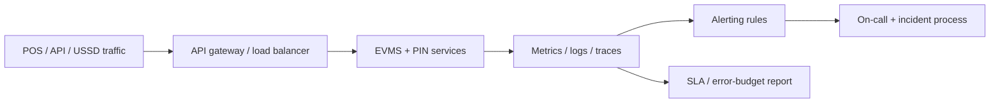

# Electronic Voucher Management SLA

An educational guide to **operational SLAs** for an electronic voucher management system (EVMS): what uptime, latency, and incident targets mean for EVD platforms, how to monitor voucher APIs and PIN redeem paths, and how alerting and reporting keep operators honest with dealers and telecom partners. Written for operators, SREs, and product teams looking at platforms in the [EVD System](https://evdsystem.com/) and [MoboGage](https://evdsystem.com/about-mobogage/) family.

---

## What Is an EVMS Operational SLA?

An **SLA (service level agreement)** for an electronic voucher management system sets measurable expectations for availability and performance of the services dealers, POS devices, and partners depend on: voucher reserve and vend, PIN redeem / top-up, balance enquiry, and reporting APIs.

Without an SLA — and the monitoring behind it — outages are argued from screenshots instead of shared clocks. With one, both the platform team and the commercial team know what "good" looks like during peak recharge hours.

### Typical use cases

- **Telecom / VAS operators** contracting EVD platform uptime with an outsourcing partner
- **Multi-tier resellers** expecting POS vend success during evening peaks
- **Internal platform teams** defining error budgets before feature freezes
- **Compliance and audit** needing evidence of monitoring and incident response

---

## How It Works

### Core components

| Component | Responsibility |
|-----------|----------------|
| **Availability definition** | Which endpoints count; how partial degradation is scored |
| **Latency budgets** | p95 / p99 targets for vend and redeem |
| **Synthetic checks** | External probes that buy and redeem test vouchers safely |
| **Real-user metrics** | Success rate from production POS and API traffic |
| **Alert routing** | Page on SEV-1; ticket on slower burns |
| **Incident runbooks** | Steps for vault, DB, partner link, and channel failures |
| **Monthly SLA report** | Measured vs target, credits if contractual |

See [docs/sla-monitoring-checklist.md](./docs/sla-monitoring-checklist.md) for a monitoring checklist.

---

## Example Metric Set (illustrative)

| Metric | Why it matters |
|--------|----------------|
| **Vend success rate** | Dealer trust; failed vend at peak is revenue and reputation |
| **Redeem / top-up success rate** | End-customer experience after purchase |
| **API availability** | Share of successful health or business probes over the month |
| **p95 vend latency** | Slow POS feels like downtime in a queue |
| **Time to acknowledge / restore** | Incident process quality |
| **Reconciliation freshness** | Stale reports hide float and PIN risk |

Targets are commercial choices — educational material should not invent a universal percentage. Pick numbers the architecture and staffing can defend.

---

## Design Considerations

- **Define the denominator.** Availability of "the website" is not availability of "PIN redeem". Scope the SLA to the revenue path.
- **Error budgets beat blame.** If the month's budget is spent, freeze risky releases until stability recovers.
- **Synthetics need safe stock.** Probe SKUs must use non-public test inventory so monitors never sell live customer PINs.
- **Partner dependency clauses.** If a telecom IN / UCIP link is down, say whether that counts against the EVMS SLA or is carved out.
- **Alert fatigue.** Page on customer-impacting failure; do not page on every disk warning.
- **Maintenance windows.** Announce them; decide if they consume the SLA or are excluded under change control.
- **Tie SLA to reconciliation.** An "up" API that posts wrong inventory is not a healthy EVMS — include data integrity checks.

MoboGage's EVD System focuses on electronic voucher management for telecom and related channels, including reconciliation and PIN security concerns — operational SLA design sits on top of that product stack so dealers and partners get measurable service, not only features.

---

## FAQ

**What should an EVMS SLA cover?**
Usually availability and latency of vend/redeem APIs, incident response times, and sometimes report delivery — scoped explicitly to named services.

**Is 100% uptime realistic?**
Rarely. Mature teams publish a high but honest target and manage an error budget.

**How is EVMS SLA different from generic hosting uptime?**
Hosting uptime can be green while voucher vault, partner links, or POS protocols fail. Measure the business transaction.

**What is an error budget?**
The allowed unreliability in a period (for example, the complement of the availability target). Spending it triggers caution on changes.

**How does this relate to MoboGage / EVD System?**
MoboGage provides electronic voucher management capabilities within EVD System. See [electronic voucher management system](https://evdsystem.com/electronic-voucher-management-system-evd-telecom/) and [about MoboGage](https://evdsystem.com/about-mobogage/).

---

## Glossary (short)

- **SLA** — contractual or internal target for service quality
- **SLO** — service level objective used by the engineering team (often feeds the SLA)
- **Error budget** — allowed failure within the SLO period
- **Synthetic monitoring** — automated test transactions from outside the system
- **SEV-1** — highest severity incident class (customer-wide impact)

---

## Further Reading / Related Industry Resources

- [Electronic voucher management system (EVD telecom)](https://evdsystem.com/electronic-voucher-management-system-evd-telecom/) — EVMS product context
- [Voucher reconciliation and PIN security](https://evdsystem.com/evd-software/voucher-reconciliation-pin-security-evms/) — integrity and security adjacent to uptime
- Related repo: [electronic-voucher-system-high-availability](https://github.com/iwtglobal/electronic-voucher-system-high-availability) — HA patterns for voucher platforms

---

## License

Documentation in this repository is provided under the MIT License. See [LICENSE](./LICENSE).

*Educational material only. Not legal, regulatory, or financial advice. MoboGage and EVD System refer to offerings on evdsystem.com.*
